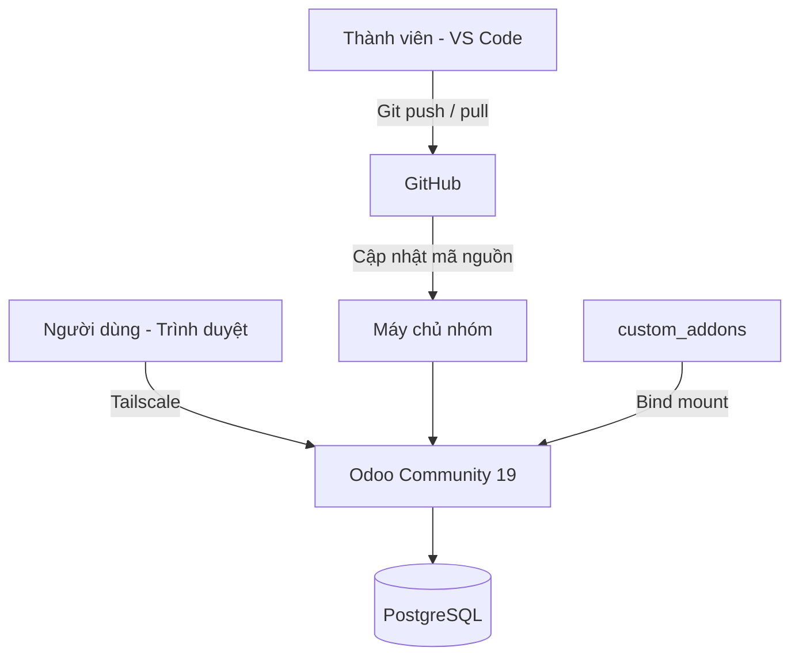

# GS25-Odoo19-TOBE

## 1. Giới thiệu

**Đề tài:** Phân tích và cải tiến quy trình quản lý hàng hóa tại GS25 chi nhánh Nguyễn Văn Trỗi.

**Nhóm thực hiện:** Nhóm 2 — Hệ thống thông tin quản lý (MIS).

Dự án khảo sát quy trình hiện tại (AS-IS), xác định hạn chế, đề xuất quy trình cải tiến (TO-BE) và hiện thực hóa các yêu cầu nghiệp vụ trên Odoo Community 19. Hệ thống là mô hình mô phỏng phục vụ học tập, không phải hệ thống chính thức của GS25.

## 2. Mục tiêu

- Chuẩn hóa quy trình đặt hàng bổ sung, nhập kho, kiểm đếm và kiểm soát hàng cận hạn.
- Tận dụng chức năng ERP tiêu chuẩn của Odoo, phát triển add-on cho các yêu cầu đặc thù.
- Tăng khả năng truy vết, kiểm soát dữ liệu, phân quyền và tự động hóa các thao tác phù hợp.
- Đánh giá giải pháp thông qua kiểm thử nghiệp vụ và kỹ thuật.

## 3. Phạm vi và tiến độ

| Module | Nghiệp vụ | Tiến độ |
| --- | --- | --- |
| `gs25_date_check` | Kiểm tra hạn sử dụng và xử lý hàng cận hạn | Hoàn thành phát triển chức năng v19.0.7.0.0; kiểm thử cuối đang thực hiện |
| `gs25_receiving` | Nhập kho và kiểm đếm hàng hóa | Đã có cấu trúc module; chưa xác nhận hoàn thành chức năng |
| `gs25_replenishment` | Đặt hàng bổ sung | Đã có cấu trúc module; chưa xác nhận hoàn thành chức năng |

Các cải tiến Receiving và Replenishment là phạm vi dự kiến, không phải chức năng đã được nghiệm thu. Dự án không giả định kết nối với POS hoặc kho tổng thực tế của GS25.

## 4. Công nghệ sử dụng

| Công nghệ | Vai trò |
| --- | --- |
| Odoo Community 19 | Nền tảng ERP và framework phát triển module |
| Python, Odoo ORM | Mô hình dữ liệu và xử lý nghiệp vụ |
| XML, CSV | Giao diện, cấu hình, dữ liệu và quyền truy cập |
| PostgreSQL | Lưu trữ dữ liệu và ràng buộc toàn vẹn |
| Docker Compose | Triển khai môi trường Odoo và PostgreSQL |
| Tailscale | Kết nối riêng đến máy chủ nhóm |
| VS Code, Git, GitHub | Phát triển và quản lý phiên bản mã nguồn |

## 5. Kiến trúc hệ thống



Odoo Community là môi trường chính để phát triển, kiểm thử và demo. Odoo Education có thể dùng để tham khảo bổ sung; hai môi trường không mặc nhiên chia sẻ dữ liệu.

Môi trường phát triển: `gs25_mis_dev`. Môi trường trình diễn dự kiến: `gs25_mis_demo`. Máy chủ, Docker và Tailscale cần hoạt động để thành viên truy cập hệ thống từ xa.

## 6. Cấu trúc repository

```text
Nhom2_GS25-Odoo19-TOBE/
├── custom_addons/
│   ├── gs25_date_check/
│   ├── gs25_receiving/
│   └── gs25_replenishment/
├── .gitignore
└── README.md
```

Mỗi add-on chứa manifest, mô hình dữ liệu, giao diện, cấu hình phân quyền và các thành phần bổ sung theo nghiệp vụ. Date Check có thêm dữ liệu sequence, cron, wizard và migration.

## 7. Chức năng Date Check

- Phân loại lô hàng theo hạn sử dụng và theo dõi tồn kho tại `NVT/Tồn kho`.
- Lập phiếu kiểm tra, gửi quản lý xác nhận, yêu cầu bổ sung và hủy phiếu theo điều kiện nghiệp vụ.
- Xử lý ưu tiên bán, tiếp tục theo dõi hoặc loại bỏ hàng hóa bằng nghiệp vụ Scrap của Odoo.
- Lưu lịch sử, người thực hiện, thời điểm và kết quả xử lý.
- Sinh mã phiếu tự động, kiểm soát quyền truy cập và chống xử lý lặp.
- Thông báo kết quả xử lý qua Discuss và tự động nhắc lịch kiểm tra lại mỗi 5 phút nếu đủ điều kiện.

## 8. Cài đặt và triển khai

### Yêu cầu

- Môi trường Odoo Community 19 và PostgreSQL đã được cấu hình bằng Docker Compose.
- Thư mục `custom_addons` của repository được mount vào đường dẫn add-on của Odoo.
- Tài khoản quản trị để cài đặt/nâng cấp module.

### Lấy mã nguồn

```bash
git clone https://github.com/TrangPham-svg/Nhom2_GS25-Odoo19-TOBE.git
cd Nhom2_GS25-Odoo19-TOBE
git switch develop
```

### Cập nhật trên máy chủ hiện tại

Sao lưu database trước khi nâng cấp. Sau khi đã kiểm tra và cập nhật mã nguồn trên máy chủ Windows của nhóm:

```powershell
cd C:\Users\PC\GS25-Odoo
docker compose restart odoo
```

Trong Odoo, bật chế độ nhà phát triển nếu cần, cập nhật danh sách ứng dụng và cài đặt hoặc nâng cấp `GS25 - Expiration Date Check`. Module phụ thuộc `stock`, `product_expiry` và `mail`.

Cấu hình kho Nguyễn Văn Trỗi, theo dõi sản phẩm theo lô, hạn sử dụng, tồn kho, múi giờ và quyền người dùng. Kiểm tra tác vụ theo lịch `GS25 - Nhắc lịch kiểm tra lại` đang hoạt động. Người nhận cần có quyền phù hợp và cấu hình thông báo trong Odoo.

Cấu hình Docker và thông tin kết nối được quản lý riêng trên máy chủ; repository hiện không chứa bộ cấu hình triển khai Docker đầy đủ.

## 9. Quy trình làm việc nhóm

- Sử dụng nhánh `develop` để tích hợp mã nguồn phát triển; tạo nhánh chức năng khi thực hiện thay đổi độc lập.
- Kiểm tra `git status` và `git diff` trước khi commit; chỉ stage các file liên quan.
- Commit có nội dung rõ ràng, push lên GitHub và review trước khi tích hợp thay đổi của thành viên.
- Kiểm thử trên database phát triển trước khi đưa sang môi trường demo.
- Không commit mật khẩu, token, file `.env`, database dump chứa dữ liệu nhạy cảm, `__pycache__` hoặc file `.pyc`.

## 10. Kiểm thử và công việc tiếp theo

Cập nhật ngày 22/11/2026:

| Hạng mục | Kết quả |
| --- | --- |
| Date Check — chức năng nghiệp vụ và thông báo xử lý | Đã triển khai và kiểm thử các luồng chính |
| NL01, NL02, NL03, NL05, NL06 | Đạt theo kiểm thử đã ghi nhận |
| NL04 — bỏ qua lô hết tồn | Không phát sinh nhắc lịch; cần lưu minh chứng đầy đủ điều kiện kiểm thử |
| TC07 — xử lý đồng thời | Chờ kiểm thử |
| TC08 — ràng buộc duy nhất mã phiếu tại PostgreSQL | Chờ kiểm thử |
| Kiểm thử hồi quy, tích hợp và triển khai demo | Chưa hoàn tất |

Minh chứng tự động hóa: phiếu DC-020 có lịch kiểm tra lại 03:20 ngày 22/11/2026; OdooBot tự động gửi thông báo lúc 03:22 mà không cần chạy thủ công.

Các bước tiếp theo: hoàn thiện tài liệu Date Check, kiểm thử kỹ thuật cuối, phát triển Receiving và Replenishment, kiểm thử tích hợp ba module và chuẩn bị demo.

## 11. Nhóm thực hiện và giấy phép

Dự án được thực hiện bởi Nhóm 2 trong khuôn khổ đồ án MIS. Module Date Check khai báo giấy phép LGPL-3 trong manifest. Các thành phần Odoo và thư viện phụ thuộc tuân theo giấy phép tương ứng.

