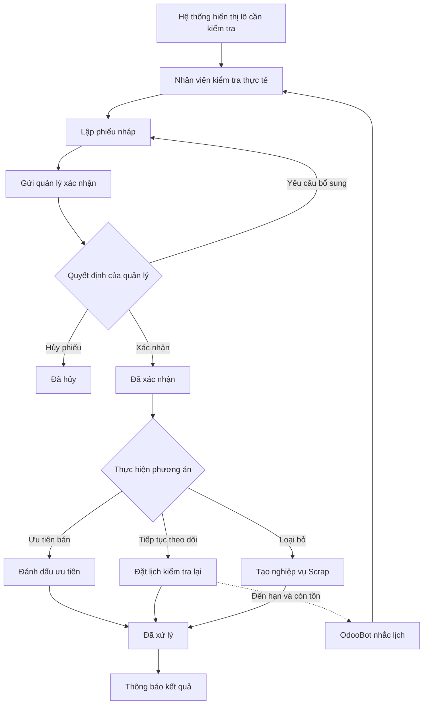

# GS25 – Expiration Date Check

Module `gs25_date_check` | Odoo Community 19 | Phiên bản `19.0.7.0.0`

**Đề tài:** Phân tích và cải tiến quy trình quản lý hàng hóa tại GS25 chi nhánh Nguyễn Văn Trỗi.

**Thực hiện:** Nhóm 2. Đây là hệ thống mô phỏng phục vụ đồ án MIS, không phải hệ thống chính thức của GS25.

## 1. Mục tiêu

Hỗ trợ nhân viên phát hiện hàng cận hạn, ghi nhận kết quả kiểm tra thực tế và trình quản lý quyết định xử lý. Tập trung lịch sử kiểm tra, kết nối với tồn kho Odoo và tự động nhắc lịch theo dõi nhằm giảm nguy cơ bỏ sót hàng cần kiểm tra.

## 2. Chức năng

- Xác định trạng thái hạn sử dụng theo lô: chưa có hạn, bình thường, cận hạn và hết hạn.
- Theo dõi số lượng thực tế tại `NVT/Tồn kho` và các vị trí con nội bộ; danh sách Date Check chỉ hiển thị lô còn tồn tại phạm vi này.
- Lọc hàng cận hạn (ngưỡng hai ngày lịch), hết hạn, chưa xử lý, ưu tiên bán, đang theo dõi và quá hạn kiểm tra lại.
- Lập phiếu kiểm tra, tự động sinh mã `DC-001`, `DC-002`, ... và kiểm soát mã trùng.
- Gửi quản lý xác nhận, yêu cầu bổ sung hoặc hủy phiếu theo điều kiện nghiệp vụ.
- Thực hiện phương án ưu tiên bán, tiếp tục theo dõi hoặc loại bỏ hàng hóa.
- Lưu lịch sử kiểm tra, người xử lý, thời điểm, số lượng và ghi chú xử lý.
- Tìm kiếm, lọc và nhóm phiếu theo trạng thái, sản phẩm, số lô, người thực hiện và ngày kiểm tra.
- Tự động thông báo kết quả xử lý và nhắc lịch kiểm tra lại qua hệ thống thông báo Odoo.

## 3. Quy trình nghiệp vụ TO-BE



### Trạng thái phiếu

| Trạng thái | Ý nghĩa |
|---|---|
| `draft` | Nháp, nhân viên lập hoặc bổ sung thông tin |
| `waiting` | Chờ quản lý xác nhận |
| `approved` | Đã xác nhận, chờ thực hiện xử lý |
| `done` | Đã xử lý, không được thực hiện lại |
| `cancelled` | Đã hủy, lưu lý do và thông tin quản lý |

### Phương án xử lý

| Phương án | Tác động |
|---|---|
| Ưu tiên bán (`priority_sale`) | Đánh dấu lô và số lượng ưu tiên; không tự giảm giá hoặc trừ tồn kho |
| Tiếp tục theo dõi (`monitor`) | Ghi nhận số lượng theo dõi và lịch kiểm tra lại; không trừ tồn kho |
| Loại bỏ (`remove`) | Tạo và xác nhận nghiệp vụ `stock.scrap` để cập nhật tồn kho |

### Kiểm soát nghiệp vụ

- Số lượng kiểm tra phải dương, hợp lệ và không vượt tồn kho khi gửi phiếu, thực hiện xử lý.
- Không ưu tiên bán hàng hết hạn hoặc không đạt chất lượng.
- Phải ghi chú khi hàng không đạt yêu cầu hoặc đề xuất loại bỏ; phải có ghi chú khi thực hiện loại bỏ.
- Lịch kiểm tra lại phải ở tương lai tại thời điểm xử lý.
- Phiếu đã xử lý không được sửa hoặc thực hiện lại qua quy trình nghiệp vụ.
- Phiếu trả về bổ sung giữ lịch sử phản hồi; phiếu hủy phải có lý do.
- Việc đánh dấu ưu tiên hoặc theo dõi không phải là nghiệp vụ giữ hàng (reservation).

## 4. Phân quyền

| Quyền | Nhân viên Date Check | Quản lý Date Check |
|---|---|---|
| Tạo phiếu | Có | Có |
| Sửa phiếu nháp của mình | Có | Có |
| Xem phiếu của mình | Có | Có |
| Xem phiếu đã xử lý của người khác | Có | Có |
| Xem toàn bộ phiếu | Không | Có |
| Xóa phiếu nháp chưa từng trả bổ sung | Phiếu của mình | Có, kể cả phiếu người khác |
| Xác nhận, trả bổ sung, hủy theo điều kiện | Không | Có |
| Thực hiện phương án xử lý | Không | Có |

Nhóm quản lý kế thừa nhóm nhân viên. Quyền Date Check kết hợp ACL, record rules và kiểm tra tại tầng Python. Người thực hiện nghiệp vụ kho cần thêm quyền Inventory phù hợp. Phạm vi hiện tại là mô phỏng một chi nhánh, chưa thiết kế phân tách dữ liệu toàn diện cho nhiều cửa hàng.

## 5. Mô hình dữ liệu

| Model | Vai trò |
|---|---|
| `stock.lot` | Mở rộng lô hàng, trạng thái hạn dùng, tồn kho NVT, phương án gần nhất và lịch nhắc |
| `gs25.date.check.record` | Phiếu kiểm tra, phê duyệt, xử lý và lịch sử |
| `gs25.date.check.cancel.wizard` | Nhập lý do hủy |
| `gs25.date.check.process.wizard` | Nhập thông tin thực hiện xử lý |
| `stock.quant` | Đọc tồn kho theo lô và vị trí |
| `stock.scrap` | Nghiệp vụ loại bỏ hàng hóa tiêu chuẩn |
| `ir.sequence` | Sinh mã phiếu kiểm tra |
| `ir.cron` | Tác vụ tự động nhắc lịch |
| `mail.thread` | Cơ chế thông báo của phiếu kiểm tra |

Một lô có thể có nhiều phiếu kiểm tra. Thông tin xử lý trên lô phản ánh phương án mới nhất; các phiếu đã xử lý lưu lịch sử độc lập. Mã phiếu có ràng buộc duy nhất ở cơ sở dữ liệu. Mã nguồn sử dụng khóa bản ghi PostgreSQL nhằm kiểm soát thao tác đồng thời; kiểm thử chuyên biệt còn nằm trong kế hoạch cuối kỳ.

## 6. Tự động hóa

### Thông báo kết quả xử lý

Sau khi xử lý thành công, hệ thống gửi thông báo cho người dùng nội bộ đang hoạt động, thuộc nhóm Date Check, có quyền đọc phiếu và thuộc công ty phù hợp; không gửi lại cho chính người thực hiện. Nội dung gồm mã phiếu, sản phẩm, số lô, phương án, số lượng, người xử lý và lịch kiểm tra lại nếu có.

### Nhắc lịch kiểm tra lại

Tác vụ `GS25 - Nhắc lịch kiểm tra lại` gọi `model._gs25_cron_monitor_reminder()` trên model `stock.lot`, định kỳ mỗi 5 phút. Điều kiện gửi:

- Lô đang ở trạng thái theo dõi và có lịch đã đến hạn.
- Lô còn tồn tại NVT.
- Lịch hiện tại chưa được gửi nhắc.

Thông báo cung cấp phiếu theo dõi, sản phẩm, số lô, số lượng theo dõi, tồn kho hiện tại, thời điểm kiểm tra lại và liên kết phiếu. Cờ `gs25_reminder_sent` kiểm soát gửi trùng và được đặt lại khi có phương án xử lý mới. Cron không tự tạo phiếu kiểm tra và không thay đổi tồn kho.

Nút Chạy thủ công chỉ dùng để kiểm thử hoặc bảo trì. Khi vận hành, giữ tác vụ hoạt động và máy chủ Odoo chạy. Thông báo có thể đến sau thời điểm đặt lịch vì tác vụ chạy định kỳ.

## 7. Cấu trúc thư mục

```text
gs25_date_check/
├── controllers/
├── data/
│   ├── ir_cron_data.xml
│   └── ir_sequence_data.xml
├── demo/
│   └── demo.xml
├── migrations/
│   └── 19.0.3.0.0/
│       ├── pre-migrate.py
│       └── post-migrate.py
├── models/
│   ├── __init__.py
│   ├── models.py
│   └── date_check_record.py
├── security/
│   ├── security.xml
│   └── ir.model.access.csv
├── views/
│   ├── views.xml
│   ├── date_check_record_views.xml
│   └── templates.xml
├── wizard/
│   ├── __init__.py
│   ├── cancel_date_check_wizard.py
│   ├── cancel_date_check_wizard_views.xml
│   ├── process_date_check_wizard.py
│   └── process_date_check_wizard_views.xml
├── __init__.py
├── __manifest__.py
└── README.md
```

Migration `19.0.3.0.0` chuẩn hóa mã phiếu cũ và đồng bộ sequence, nhằm hạn chế xung đột mã khi nâng cấp dữ liệu.

## 8. Cài đặt và nâng cấp

**Yêu cầu:** Odoo Community 19, PostgreSQL và các dependency `stock`, `product_expiry`, `mail`. Thư mục `custom_addons` phải được mount vào addons path của Odoo. Cần cấu hình kho NVT, theo dõi số lô, hạn sử dụng và dữ liệu tồn kho mẫu.

1. Sao lưu cơ sở dữ liệu trước khi nâng cấp.
2. Cập nhật code của module trong repository và kiểm tra đường dẫn mount.
3. Trên máy chủ Windows của nhóm, chạy PowerShell:

   ```powershell
   cd C:\Users\PC\GS25-Odoo
   docker compose restart odoo
   ```

4. Đăng nhập database `gs25_mis_dev`, bật chế độ nhà phát triển nếu cần và cập nhật danh sách ứng dụng.
5. Tìm `GS25 - Expiration Date Check` trong Apps, cài đặt mới hoặc nâng cấp module hiện có.
6. Gán quyền Date Check phù hợp cho nhân viên và quản lý; kiểm tra quyền kho đối với người xử lý Scrap.
7. Kiểm tra tác vụ theo lịch đang hoạt động và tùy chọn thông báo Trong Odoo của người nhận.
8. Kiểm thử trên môi trường dev trước khi triển khai sang `gs25_mis_demo`.

Không lưu mật khẩu, token, database dump hoặc dữ liệu cá nhân vào GitHub.

## 9. Hướng dẫn sử dụng

**Nhân viên:** mở GS25 Date Check > Kiểm tra hạn sử dụng, kiểm tra lô thực tế, lập phiếu trong Phiếu kiểm tra, nhập kết quả và đề xuất, sau đó gửi quản lý. Theo dõi phản hồi và thông báo trong Discuss.

**Quản lý:** mở phiếu đang chờ xác nhận, kiểm tra dữ liệu, xác nhận hoặc yêu cầu bổ sung/hủy theo điều kiện. Với phiếu đã xác nhận, chọn thực hiện xử lý, nhập thông tin cần thiết và xác nhận hoàn thành. Đối chiếu tồn kho đối với phương án loại bỏ.

**Quản trị kỹ thuật:** kiểm tra Cron tại Thiết lập > Kỹ thuật > Tác vụ theo lịch, xem log Docker khi cần. Không cần chạy Cron thủ công trong quy trình sử dụng thông thường.

## 10. Kết quả kiểm thử

Cập nhật ngày 22/11/2026 trên môi trường phát triển.

| Mã | Nội dung | Kết quả |
|---|---|---|
| TC01–TC06 | Bộ kiểm thử nghiệp vụ đã thực hiện trước đó | PASS theo kết quả nhóm ghi nhận |
| TC07 | Xử lý đồng thời bằng hai phiên đăng nhập | Chờ kiểm thử |
| TC08 | Ràng buộc duy nhất của mã phiếu ở PostgreSQL | Chờ kiểm thử |
| NL01 | Không nhắc trước thời hạn | PASS |
| NL02 | Tự động nhắc khi đến hạn | PASS – DC-015, 02:20 → 02:22 |
| NL03 | Không gửi nhắc trùng | PASS |
| NL04 | Không nhắc khi tồn kho NVT bằng 0 | Không nhận thông báo; cần lưu minh chứng trạng thái theo dõi và lịch đã đến hạn |
| NL05 | Tự động nhắc lại theo lịch mới | PASS – DC-020, 03:20 → 03:22 |
| NL06 | Không nhắc lịch cũ khi đổi phương án | PASS |

Kết quả trên là kiểm thử thủ công qua giao diện, không phải báo cáo chạy bộ test tự động. Các mã phiếu và thời điểm là dữ liệu kiểm thử, không phải giao dịch GS25 thực tế.

## 11. Lịch sử phiên bản

| Phiên bản/mốc | Nội dung |
|---|---|
| `19.0.3.0.0` | Chuẩn hóa mã phiếu, sequence, ràng buộc duy nhất và migration |
| `19.0.4.0.0` – `19.0.5.0.0` | Hoàn thiện phân quyền và chức năng tìm kiếm, lọc, nhóm dữ liệu |
| `19.0.6.0.0` | Thông báo kết quả xử lý |
| `19.0.7.0.0` | Tự động nhắc lịch kiểm tra lại và kiểm soát gửi trùng |

## 12. Trạng thái và công việc tiếp theo

Đã hoàn thành giai đoạn phát triển chức năng trong phạm vi hiện tại. Chưa xác nhận phát hành ổn định cuối cùng.

- [ ] Hoàn thiện minh chứng NL04 và kiểm thử TC07, TC08.
- [ ] Kiểm thử tổng thể, hồi quy và tích hợp với các module còn lại.
- [ ] Chuẩn bị dữ liệu và triển khai phiên bản đã kiểm thử trên database demo.

## 13. Giấy phép

LGPL-3, theo khai báo trong `__manifest__.py` của module.
