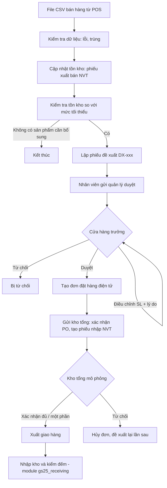

# GS25 – Replenishment Management

Module `gs25_replenishment` | Odoo Community 19 | Phiên bản `19.0.2.0.0`

**Đề tài:** Phân tích và cải tiến quy trình quản lý hàng hóa tại GS25 chi nhánh Nguyễn Văn Trỗi.

**Thực hiện:** Nhóm 2 – Nhóm A (Đặt hàng bổ sung). Đây là hệ thống mô phỏng phục vụ đồ án MIS, không phải hệ thống chính thức của GS25. Module không kết nối với máy POS hoặc hệ thống kho tổng thực tế; dữ liệu POS được import từ file CSV và phản hồi của kho tổng được mô phỏng trong Odoo.

## 1. Mục tiêu

Chuẩn hóa quy trình đặt hàng bổ sung tại cửa hàng: ghi nhận sản lượng bán từ POS, phát hiện sản phẩm dưới mức tồn tối thiểu, tự động đề xuất số lượng cần đặt, để cửa hàng trưởng kiểm tra – duyệt, sau đó tạo đơn đặt hàng điện tử gửi kho tổng và theo dõi phản hồi.

## 2. Chức năng theo task

| Task | Chức năng | Thành phần chính |
| --- | --- | --- |
| A01 | Cấu hình Inventory và Purchase: kho cửa hàng (mặc định kho mã `NVT`), đối tác kho tổng mô phỏng, tham số tính đề xuất, màn hình kiểm tra cấu hình | `res.company`, `data/res_partner_data.xml` |
| A02 | Import file CSV dữ liệu bán hàng POS, kiểm tra cột, mã sản phẩm (mã vạch hoặc mã nội bộ), số lượng, thời gian bán | `gs25.pos.sale.import`, `gs25.pos.sale.line` |
| A03 | Tạo và xác thực phiếu xuất bán `NVT/Tồn kho → Khách hàng` theo nghiệp vụ kho chuẩn; chặn import lại cùng file, chặn dòng trùng trong file và dòng đã ghi nhận ở phiếu khác (unique index PostgreSQL) | `action_process_stock` |
| A04 | Thiết lập mức tồn tối thiểu/tối đa và bội số đặt hàng theo sản phẩm trên quy tắc bổ sung chuẩn; luôn ở chế độ thủ công để Odoo không tự tạo đơn mua | `stock.warehouse.orderpoint` |
| A05 | Kiểm tra tồn hiện có, sắp nhập, sắp xuất, tồn dự báo; phát hiện sản phẩm có tồn dự báo ≤ mức tối thiểu; không đề xuất lặp sản phẩm đang có đề xuất chưa xử lý; tự động kiểm tra hằng ngày | `_gs25_get_replenishment_candidates`, cron |
| A06 | Tự động tính số lượng đề xuất theo tồn dự báo, mức tối thiểu/tối đa, sức bán trung bình, thời gian giao và số ngày dự trữ | `_gs25_compute_suggested_qty` |
| A07 | Tổng hợp danh sách đề xuất trên phiếu `DX-xxx`, báo cáo tổng hợp theo sản phẩm (list/pivot) | `gs25.replenishment.proposal` |
| A08 | Cửa hàng trưởng điều chỉnh "SL duyệt", bắt buộc nhập lý do khi khác số lượng hệ thống đề xuất; lưu lịch sử điều chỉnh | `gs25.replenishment.proposal.line` |
| A09 | Duyệt hoặc từ chối đề xuất (wizard nhập lý do), thông báo cho người lập | `action_approve`, `gs25.replenishment.reject.wizard` |
| A10 | Tạo đơn đặt hàng điện tử (`purchase.order`) gửi kho tổng, nhận hàng tại kho cửa hàng | `action_create_purchase_order` |
| A11 | Gửi đơn (xác nhận PO, tạo phiếu nhập dự kiến); kho tổng mô phỏng tiếp nhận, xác nhận đủ / một phần / từ chối, xuất giao; nhật ký trạng thái | `purchase.order`, `gs25.replenishment.dw.log`, `gs25.dw.response.wizard` |
| A12 | Kiểm thử tự động toàn bộ quy trình | `tests/test_replenishment_flow.py` |

## 3. Quy trình nghiệp vụ TO-BE



### Trạng thái phiếu đề xuất

| Trạng thái | Ý nghĩa |
| --- | --- |
| Nháp | Hệ thống vừa lập; nhân viên có thể bỏ sản phẩm, cập nhật số liệu, ghi chú |
| Chờ quản lý duyệt | Quản lý kiểm tra, điều chỉnh SL duyệt |
| Đã duyệt | Chờ tạo đơn đặt hàng |
| Đã tạo đơn đặt hàng | Đã có PO; theo dõi trạng thái kho tổng |
| Bị từ chối / Đã hủy | Kết thúc, lưu lịch sử |

### Trạng thái phía kho tổng (trên đơn đặt hàng)

Chưa gửi → Đã gửi kho tổng → Kho tổng đã tiếp nhận → Xác nhận đủ hàng / Xác nhận một phần → Đang giao hàng. Kho tổng có thể từ chối khi đơn ở trạng thái Đã gửi hoặc Đã tiếp nhận.

### Công thức đề xuất (A06)

```text
Tồn dự báo   = Tồn hiện có + Sắp nhập − Sắp xuất            (tại NVT/Tồn kho và vị trí con)
Bán TB/ngày  = Tổng SL bán đã ghi nhận trong N ngày gần nhất / N
Nhu cầu      = Bán TB/ngày × (Thời gian giao + Số ngày dự trữ)
Mức mục tiêu = max(Tồn tối đa, Tồn tối thiểu + Nhu cầu)
SL đề xuất   = Mức mục tiêu − Tồn dự báo, làm tròn lên theo bội số đặt hàng
```

Chỉ đề xuất khi Tồn dự báo ≤ Tồn tối thiểu. Ví dụ: 7UP tồn 16, tối thiểu 20, tối đa 40, bán 2/ngày, giao 1 ngày + dự trữ 2 ngày, bội số 6 → mục tiêu max(40, 26) = 40 → cần 24 → đề xuất 24.

### Kiểm soát nghiệp vụ

- Trạng thái chỉ thay đổi qua nút nghiệp vụ; các trường xử lý được bảo vệ khỏi chỉnh sửa trực tiếp.
- Khóa bản ghi (`FOR UPDATE`) và khóa advisory khi cập nhật tồn kho, lập đề xuất để tránh xử lý đồng thời.
- Không tự cộng trừ `stock.quant`: tồn kho được cập nhật bằng phiếu xuất bán và phiếu nhập chuẩn.
- Không cho bán vượt tồn khả dụng; toàn bộ phiếu import bị hủy cập nhật nếu thiếu hàng.
- Đơn đã gửi kho tổng không được sửa sản phẩm, số lượng, kho tổng hoặc kho nhận.
- Kho tổng xác nhận một phần: giảm số lượng trên đơn và phiếu nhập dự kiến, không phát sinh phiếu trả hàng.

## 4. Phân quyền

| Nhóm | Quyền |
| --- | --- |
| GS25 Replenishment User (nhân viên) | Import dữ liệu POS, cập nhật tồn kho, kiểm tra tồn & lập đề xuất, gửi duyệt |
| GS25 Replenishment Manager (cửa hàng trưởng) | Quyền nhân viên + thiết lập mức tồn, điều chỉnh, duyệt/từ chối, tạo và gửi đơn đặt hàng |
| GS25 Kho tổng (mô phỏng) | Xem đơn đặt hàng, tiếp nhận, xác nhận đủ/một phần, từ chối, xuất giao |
| Quản trị hệ thống | Quyền quản lý + cấu hình chung |

## 5. Mô hình dữ liệu

| Model | Vai trò |
| --- | --- |
| `gs25.pos.sale.import` | Phiếu import dữ liệu bán hàng POS (`POS-xxx`) |
| `gs25.pos.sale.line` | Dòng bán hàng; khóa `sale_key` = mã hóa đơn + số dòng (hoặc mã SP) |
| `gs25.replenishment.proposal` | Phiếu đề xuất đặt hàng (`DX-xxx`) |
| `gs25.replenishment.proposal.line` | Dòng sản phẩm đề xuất, số liệu tồn, SL đề xuất, SL duyệt |
| `gs25.replenishment.dw.log` | Nhật ký trạng thái phía kho tổng |
| `stock.warehouse.orderpoint` (kế thừa) | Mức tồn tối thiểu/tối đa, bội số đặt hàng GS25 |
| `purchase.order` (kế thừa) | Đơn đặt hàng điện tử, trạng thái kho tổng |
| `res.company` (kế thừa) | Cấu hình đặt hàng bổ sung |

## 6. Tự động hóa

- Tác vụ theo lịch `GS25 - Kiểm tra tồn kho và lập đề xuất đặt hàng` chạy mỗi ngày (bật/tắt theo công ty), lập phiếu nguồn "Hệ thống tự động" và thông báo cho nhân viên.
- Thông báo Discuss: gửi duyệt → quản lý; duyệt/từ chối → người lập; gửi đơn → kho tổng; phản hồi kho tổng → quản lý.

## 7. Định dạng file CSV bán hàng POS

```csv
receipt_ref,line_no,sale_datetime,product_code,quantity
HD0001,1,2026-11-26 08:15:00,GS25-7UP,2
HD0001,2,2026-11-26 08:15:00,GS25-SW,1
```

- `product_code`: mã vạch hoặc mã nội bộ của sản phẩm; `line_no` không bắt buộc.
- Chấp nhận tên cột tiếng Việt không dấu: `ma_hoa_don`, `dong`, `thoi_gian_ban`, `ma_san_pham`, `so_luong`.
- Dấu phân cách `,` hoặc `;`; thời gian theo múi giờ người dùng (mặc định Asia/Ho_Chi_Minh), định dạng `YYYY-MM-DD HH:MM[:SS]` hoặc `DD/MM/YYYY HH:MM[:SS]`.
- File mẫu: `static/sample/pos_sales_sample.csv`.

## 8. Cài đặt và cấu hình

1. Cập nhật mã nguồn, khởi động lại Odoo, cập nhật danh sách ứng dụng, cài đặt `GS25 - Replenishment Management` (phụ thuộc `stock`, `purchase_stock`, `mail`).
2. Vào **GS25 Đặt hàng bổ sung → Cấu hình → Thiết lập chung**: kiểm tra kho cửa hàng (NVT), kho tổng nhận đơn và các tham số. Mục "Kiểm tra cấu hình" phải hiển thị đủ dấu ✅.
3. Gán nhóm quyền cho nhân viên, cửa hàng trưởng và tài khoản kho tổng mô phỏng.
4. Vào **Cấu hình → Mức tồn kho tối thiểu** để nhập mức tồn tối thiểu/tối đa, bội số đặt hàng cho từng sản phẩm.

## 9. Hướng dẫn sử dụng

1. **Dữ liệu bán hàng POS** → Tạo → chọn file CSV → *Kiểm tra dữ liệu* → xem dòng lỗi/trùng → *Cập nhật tồn kho*.
2. **Kiểm tra tồn kho & lập đề xuất** → hệ thống mở phiếu đề xuất (hoặc báo không có sản phẩm cần bổ sung).
3. Nhân viên kiểm tra danh sách → *Gửi quản lý duyệt*.
4. Cửa hàng trưởng điều chỉnh SL duyệt (kèm lý do) → *Duyệt đề xuất* hoặc *Từ chối*.
5. *Tạo đơn đặt hàng* → trên đơn chọn *Gửi kho tổng*.
6. Tài khoản kho tổng: *Tiếp nhận đơn* → *Xác nhận đủ hàng* / *Xác nhận một phần* / *Từ chối* → *Xuất giao hàng*.
7. Nhận hàng tại phiếu nhập NVT (tích hợp module `gs25_receiving`).

## 10. Kết quả kiểm thử

Chạy kiểm thử tự động:

```bash
odoo-bin -d <database> -u gs25_replenishment --test-tags /gs25_replenishment --stop-after-init
```

| Mã | Nội dung | Kết quả |
| --- | --- | --- |
| test_01 | Cấu hình kho NVT, kho tổng, ràng buộc tham số | Đạt |
| test_02 | Import CSV, tìm SP theo mã vạch/mã nội bộ, trừ tồn kể cả SP quản lý lô | Đạt |
| test_03 | Chặn import lại file, dòng trùng trong file và dòng đã ghi nhận | Đạt |
| test_04 | Dòng lỗi: SP không tồn tại, SL sai/âm, thời gian tương lai, thiếu cột | Đạt |
| test_05 | Không trừ tồn khi tồn khả dụng không đủ | Đạt |
| test_06 | Bảo vệ trạng thái, dòng bán hàng, không xóa phiếu đã cập nhật | Đạt |
| test_07 | Mức tồn: chế độ thủ công, phân quyền, ràng buộc min/max/bội số | Đạt |
| test_08 | Công thức đề xuất số lượng | Đạt |
| test_09 | Toàn bộ quy trình: bán → đề xuất → điều chỉnh → duyệt → PO → gửi → kho tổng xác nhận → giao | Đạt |
| test_10 | Từ chối đề xuất, sản phẩm được đề xuất lại | Đạt |
| test_11 | Kho tổng xác nhận một phần, cập nhật phiếu nhập, không tạo phiếu trả | Đạt |
| test_12 | Kho tổng từ chối, hủy đơn và phiếu nhập | Đạt |
| test_13 | Tác vụ tự động lập đề xuất; chặn tạo phiếu thủ công | Đạt |
| test_14 | Bỏ sản phẩm khỏi phiếu Nháp, cập nhật lại số liệu tồn | Đạt |

Kết quả ngày 27/11/2026 trên Odoo Community 19.0 (cài chung `gs25_date_check`, `product_expiry`): **14/14 đạt**. Cần kiểm thử bổ sung trên database phát triển `gs25_mis_dev` với dữ liệu kho NVT/DW thực tế của nhóm.

## 11. Giấy phép

LGPL-3, theo khai báo trong manifest.
