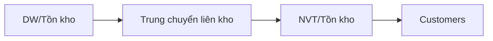
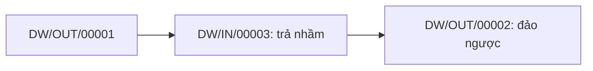
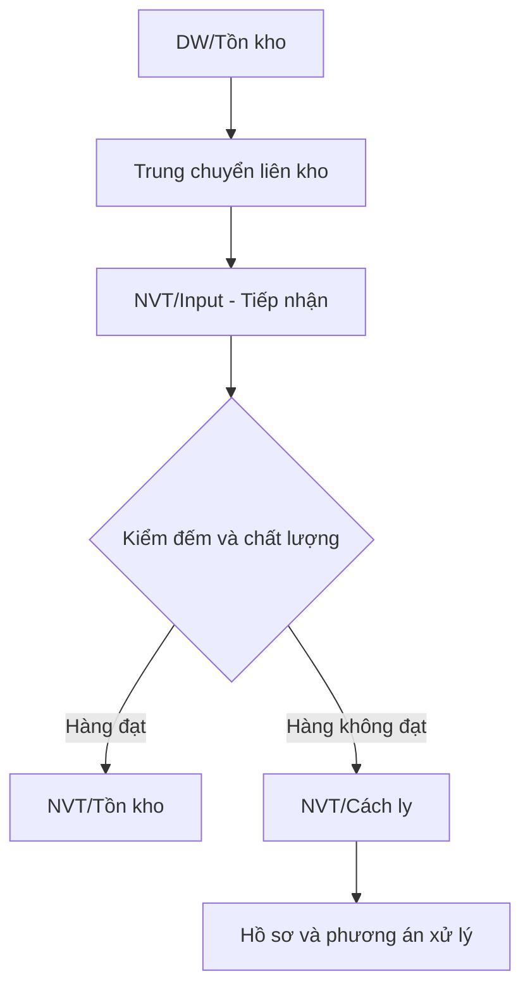

# Kiến thức quản lý tồn kho trên Odoo 19 Community
**Dự án:** Phân tích và cải tiến quy trình quản lý hàng hóa tại GS25 chi nhánh Nguyễn Văn Trỗi

Tài liệu nội bộ dành cho thành viên Nhóm 2, phục vụ phân tích nghiệp vụ, cấu hình, lập trình và kiểm thử các module `gs25_receiving`, `gs25_replenishment` và `gs25_date_check`.

## 1. Các khái niệm nền tảng

| Khái niệm | Ý nghĩa | Ví dụ |
|---|---|---|
| Warehouse (Kho hàng) | Đơn vị tổ chức hoạt động kho | Kho tổng DW, cửa hàng NVT |
| Location (Vị trí) | Nơi ghi nhận hàng hóa trong hệ thống | DW/Tồn kho, NVT/Tồn kho |
| Route (Tuyến cung ứng) | Tập hợp quy tắc xác định luồng cung ứng | Cung cấp hàng cho NVT từ DW |
| Rule (Quy tắc) | Quy định cách tạo hoạt động dịch chuyển hàng | Kéo hàng từ Transit về NVT |
| Operation Type (Loại hoạt động) | Cấu hình một nhóm nghiệp vụ kho | Nhập kho, giao hàng, nội bộ |
| Transfer (Phiếu điều chuyển) | Chứng từ thực hiện dịch chuyển hàng | NVT/IN/00001 |
| Lot (Số lô) | Nhóm hàng cùng mã lô để truy xuất | GS25-SW-001 |
| Quant | Bản ghi số dư tồn kho theo các chiều như sản phẩm, vị trí, lô | 10 Sandwich tại NVT |

Kho hàng và vị trí không phải cùng một khái niệm. Một kho có thể chứa nhiều vị trí. Tồn kho thực tế được theo dõi theo vị trí, không chỉ theo tên kho.

## 2. Cấu trúc kho của nhóm

| Kho | Mã | Vị trí lưu kho |
|---|---|---|
| Kho tổng GS25 | DW | DW/Tồn kho |
| GS25 Nguyễn Văn Trỗi | NVT | NVT/Tồn kho |

### Các loại vị trí

| Loại | Vai trò |
|---|---|
| Nội bộ (Internal) | Lưu trữ hàng thuộc hoạt động kho nội bộ |
| Ảo (View) | Tổ chức cây vị trí, không dùng để chứa hàng trực tiếp |
| Transit | Theo dõi hàng đang luân chuyển giữa các kho |
| Nhà cung cấp (Vendor) | Nguồn hàng mua từ bên ngoài |
| Khách hàng (Customer) | Đích của giao dịch bán hàng |
| Thất thoát tồn kho (Inventory Loss) | Đối ứng cho điều chỉnh tồn kho hoặc loại bỏ tùy cấu hình |
| Sản xuất (Production) | Vị trí phục vụ nghiệp vụ sản xuất |

DW và NVT là các vị trí cha loại View; DW/Tồn kho và NVT/Tồn kho là các vị trí nội bộ. Transit giúp theo dõi hàng đã rời kho gửi nhưng chưa được kho nhận xác nhận.

## 3. Loại hoạt động và chứng từ

| Tiền tố | Nghiệp vụ | Ví dụ |
|---|---|---|
| IN | Nhập kho | NVT/IN/00001 |
| OUT | Xuất hoặc giao hàng | DW/OUT/00001 |
| INT | Điều chuyển nội bộ | NVT/INT/... |
| POS | Dịch chuyển hàng phát sinh từ bán hàng POS | NVT/POS/... |

Tiền tố giúp nhận diện chứng từ nhưng không đủ để xác định luồng hàng. Phải kiểm tra vị trí nguồn, vị trí đích, sản phẩm, lô và số lượng thực hiện.

Trạng thái thường gặp: Nháp, Đang chờ, Sẵn sàng, Hoàn tất, Đã hủy. Phiếu Sẵn sàng chưa đồng nghĩa với hàng đã nhập kho. Khi xác thực thành công, các dịch chuyển hoàn tất mới cập nhật tồn thực tế.

Chính sách vận chuyển **Càng sớm càng tốt** cho phép xử lý từng phần khi hàng sẵn sàng; **Khi tất cả sản phẩm đã sẵn sàng** ưu tiên chờ đủ hàng. Đây không phải cơ chế kiểm tra chất lượng hoặc ngăn tồn âm.

## 4. Tuyến tái cung ứng từ kho tổng

Cấu hình đã quan sát trước khi chuyển sang nhập kho hai bước gồm hai quy tắc Pull (Kéo từ):

1. DW/Tồn kho → Trung chuyển liên kho.
2. Trung chuyển liên kho → NVT/Tồn kho.

Pull Rule tạo nhu cầu dịch chuyển từ vị trí nguồn để đáp ứng nhu cầu tại đích. Việc tự động tạo chứng từ còn phụ thuộc cấu hình quy tắc, tuyến của sản phẩm và nhu cầu bổ sung.

Tuyến Mua hiện có quy tắc cho cả DW và NVT. Đây là cấu hình đã quan sát, không phải kết luận rằng cửa hàng thực tế mua trực tiếp từ nhà cung cấp. Nhóm cần thống nhất chính sách trước khi thay đổi.

### Ví dụ minh họa cung ứng 30 chai 7UP

| Giai đoạn | DW | Transit | NVT | Tổng |
|---|---:|---:|---:|---:|
| Ban đầu (giả định) | 100 | 0 | 0 | 100 |
| Kho tổng xuất 30 | 70 | 30 | 0 | 100 |
| Cửa hàng nhận 30 | 70 | 0 | 30 | 100 |

Hai phiếu liên quan trong dữ liệu nhóm là DW/OUT/00001 và NVT/IN/00001, cùng chứng từ gốc OP/00001. Bảng trên minh họa nguyên lý; số lượng ban đầu chưa được đối chiếu trực tiếp với lịch sử chi tiết.

## 5. Tình huống thực tế: xử lý tồn âm tại Transit

Trong quá trình kiểm thử, nhóm đã tạo nhầm phiếu trả hàng DW/IN/00003 từ DW/OUT/00001. Phiếu chuyển 10 chai 7UP từ Transit về DW trong khi hàng đã được tiếp nhận tại cửa hàng.

| Giai đoạn | DW | Transit | NVT | Tổng 7UP |
|---|---:|---:|---:|---:|
| Trước giao dịch nhầm (suy ra) | 70 | 0 | 30 | 100 |
| Sau giao dịch nhầm | 80 | -10 | 30 | 100 |
| Sau đảo ngược | 70 | 0 | 30 | 100 |

Đây là sai lệch phân bổ tồn theo vị trí, không phải mất 10 chai trong toàn bộ ba vị trí đang xét.

### Cách khắc phục đã thực hiện

1. Mở DW/IN/00003 và chọn Trả hàng.
2. Tạo phiếu DW/OUT/00002 với 10 chai 7UP.
3. Kiểm tra danh sách Giao hàng: nguồn DW/Tồn kho, đích Trung chuyển liên kho.
4. Xác thực phiếu và kiểm tra lại tồn kho.

Kết quả quan sát: DW còn 70 chai, NVT còn 30 chai, dòng Transit âm không còn hiển thị, phù hợp với số dư dự kiến bằng 0. Lô Sandwich GS25-SW-001 tại NVT vẫn còn 10 đơn vị.

Không xóa chứng từ hoàn tất hoặc sửa trực tiếp PostgreSQL để che sai lệch. Phiếu đảo ngược giữ được lịch sử nghiệp vụ. Chỉ sử dụng phương án này khi đã xác minh giao dịch gốc, số lượng và vị trí thực tế; không áp dụng máy móc cho mọi trường hợp tồn âm.

## 6. Kiểm đếm nhập hàng và kiểm kê thực tế

| Tiêu chí | Kiểm đếm nhập hàng | Kiểm kê thực tế |
|---|---|---|
| Thời điểm | Khi nhận hàng | Khi đối chiếu hàng đang lưu kho |
| Đối chiếu | Số lượng dự kiến trên phiếu và thực nhận | Tồn hệ thống và số lượng đếm thực tế |
| Chứng từ | Phiếu nhập, hồ sơ sai lệch | Điều chỉnh tồn kho |
| Mục tiêu | Nhận đúng hàng, đúng số lượng và chất lượng | Đảm bảo số dư phản ánh thực tế |

BPMN AS-IS và TO-BE của nhóm tập trung vào **nhập kho và kiểm đếm khi nhận hàng**, không phải toàn bộ nghiệp vụ kiểm kê định kỳ.

Màn hình Tồn kho → Hoạt động → Kiểm kê thực tế có các cột Hiện có, Đã đếm, Chênh lệch. Không nhấn Áp dụng tất cả chỉ để xem tồn kho. Chỉ áp dụng điều chỉnh khi đã kiểm đếm và được phép xử lý sai lệch.

## 7. Nhập kho một bước, hai bước và ba bước

| Phương án | Luồng cơ bản |
|---|---|
| Một bước | Nguồn → Tồn kho |
| Hai bước | Nguồn → Tiếp nhận → Tồn kho |
| Ba bước | Nguồn → Tiếp nhận → Kiểm soát chất lượng → Tồn kho |

Nhóm đề xuất giữ DW nhập một bước, chuyển NVT sang hai bước và giữ xuất kho một bước tại cả hai kho. Đây là phương án triển khai đang chuẩn bị, chưa xác nhận hoàn thành cấu hình.

Sơ đồ là luồng mục tiêu. Tên vị trí Input thực tế cần kiểm tra sau khi lưu cấu hình. Vị trí cách ly cần thiết lập riêng, ưu tiên nằm dưới NVT nhưng ngoài cây NVT/Tồn kho để tránh đưa hàng lỗi vào phạm vi tồn bán và Date Check. Cần kiểm thử quy tắc dự trữ và phạm vi tồn khả dụng; vị trí nội bộ cách ly vẫn có thể được tính trong một số báo cáo tồn tổng.

Nhập hai bước không tự động tạo đầy đủ quy trình duyệt chất lượng. Module tùy chỉnh phải kiểm soát việc chuyển hàng đạt vào kho và cách ly hàng lỗi. Nếu thiếu hàng, chỉ ghi nhận lượng thực nhận; phần thiếu cần xử lý chứng từ và số dư Transit theo nghiệp vụ, không tự tạo hàng hoặc tự xóa sai lệch.

## 8. Số lô, hạn sử dụng và chiến lược xuất kho

- Theo dõi theo lô giúp truy xuất nguồn hàng và hạn sử dụng.
- Hàng chuyển từ DW sang NVT cần giữ đúng lô hiện có nếu sản phẩm được quản lý theo lô; không tạo lô mới tùy tiện.
- Hạn sử dụng gắn với lô và cấu hình sản phẩm. Không ghi đè hạn của lô cũ khi chưa xác minh.
- FIFO: nhập trước xuất trước; LIFO: nhập sau xuất trước; FEFO: ưu tiên ngày loại bỏ sớm nhất theo cấu hình hạn sử dụng. FEFO không thay thế kiểm tra chất lượng hay tự động cấm bán hàng hết hạn.
- Module Date Check theo dõi hàng tại NVT/Tồn kho và các vị trí con phù hợp; cần giữ tương thích khi bổ sung vị trí mới.

## 9. Phân chia chức năng chuẩn và tùy chỉnh

| Nghiệp vụ | Odoo chuẩn | Phần nhóm cần triển khai hoặc kiểm chứng |
|---|---|---|
| Quản lý kho, vị trí, điều chuyển | Có | Cấu hình đúng luồng GS25 |
| Bổ sung hàng | Có tuyến và quy tắc bổ sung | Logic đề xuất đặc thù nếu cần |
| Kiểm đếm nhận hàng | Có phiếu và số lượng thực hiện | Hồ sơ sai lệch, bằng chứng, duyệt |
| Kiểm tra chất lượng | Có thể tổ chức bằng vị trí và điều chuyển | Luồng kiểm tra, cách ly, chặn nhập hàng lỗi trong Community của nhóm |
| Lô và hạn sử dụng | Có | Kiểm tra dữ liệu và quy trình Date Check |
| Loại bỏ hàng | Có stock.scrap | Liên kết hồ sơ, quyền duyệt và kiểm soát số lượng |
| Thông báo và báo cáo | Có cơ chế chatter/activity | Nội dung, người nhận và quy trình gửi báo cáo theo TO-BE |

Kho tổng được biểu diễn như đối tác nhận báo cáo trong BPMN. Việc gửi báo cáo thật tới hệ thống kho tổng GS25 chưa được xác nhận tích hợp; trong đồ án có thể mô phỏng nội bộ và ghi rõ giới hạn.

## 10. Kiến thức kỹ thuật dành cho lập trình viên

| Model Odoo | Vai trò |
|---|---|
| stock.warehouse | Kho hàng |
| stock.location | Vị trí |
| stock.route / stock.rule | Tuyến và quy tắc |
| stock.picking.type | Loại hoạt động |
| stock.picking | Phiếu điều chuyển |
| stock.move | Nhu cầu và dịch chuyển sản phẩm |
| stock.move.line | Chi tiết thực hiện theo vị trí, lô, số lượng |
| stock.quant | Số dư tồn theo vị trí và các chiều quản lý |
| stock.lot | Lô/sê-ri |
| stock.scrap | Chứng từ loại bỏ |

Ưu tiên kế thừa model và nghiệp vụ chuẩn, sử dụng ORM và các phương thức xác thực chứng từ phù hợp phiên bản Odoo 19. Không tự cộng trừ `stock.quant` hoặc cập nhật SQL để thay thế luồng kho. Kiểm tra quyền, trạng thái, số lượng, đơn vị tính, lô, khả năng xử lý đồng thời và chống xác nhận trùng. Các model và API cụ thể cần đối chiếu mã nguồn trước khi lập trình.

## 11. Checklist triển khai gs25_receiving

- [x] Kiểm tra kho, vị trí, loại hoạt động và tuyến hiện tại.
- [x] Xử lý giao dịch trả hàng nhầm gây tồn âm Transit.
- [ ] Chuyển NVT sang nhập kho hai bước trên database phát triển.
- [ ] Kiểm tra vị trí tiếp nhận được tạo và tuyến tái cung ứng sau thay đổi.
- [ ] Tạo vị trí cách ly và kiểm tra không bị lấy hàng để bán.
- [ ] Kiểm tra cấu hình sử dụng lô hiện có khi nhận hàng liên kho.
- [ ] Kiểm thử luồng chuẩn, thiếu hàng, hàng lỗi, toàn bộ hàng lỗi và trường hợp hỗn hợp.
- [ ] Thiết kế hồ sơ sai lệch, bằng chứng, quyền duyệt và thông báo.
- [ ] Lập trình, kiểm thử và kiểm tra tương thích với Date Check, Replenishment và POS.

## 12. Nguyên tắc làm việc nhóm

Thử nghiệm trên `gs25_mis_dev`, sao lưu trước khi thay đổi cấu hình quan trọng, không thử trực tiếp trên database demo. Kiểm tra tồn theo vị trí trước và sau mỗi test. Ghi mã chứng từ, dữ liệu đầu vào, kết quả mong đợi và kết quả thực tế. Không coi một chức năng đã hoàn thành chỉ vì đã cấu hình hoặc viết code.

Tài liệu này tổng hợp kiến thức đã trao đổi và cấu hình quan sát được trong quá trình làm đồ án. Các thiết kế TO-BE và đề xuất kỹ thuật được ghi riêng với kết quả đã kiểm chứng; cần cập nhật khi nhóm hoàn tất cấu hình và kiểm thử.
